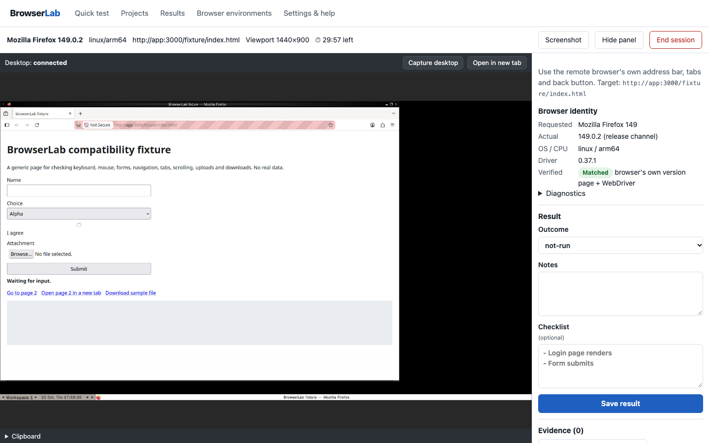
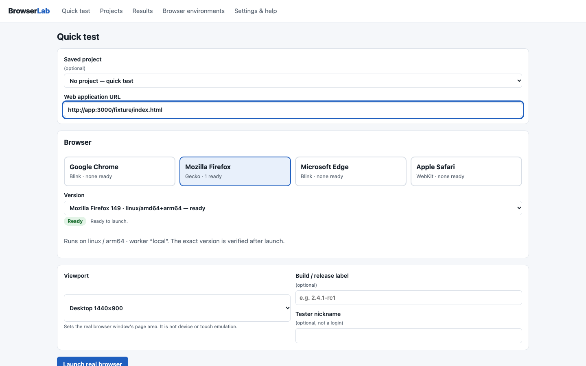

# BrowserLab

Self-hosted, Docker-first **manual browser compatibility testing** on real, verified browser versions.
Open a web app in a genuine Google Chrome, Microsoft Edge or Mozilla Firefox build (or Safari on your own Mac), use it
with your own mouse and keyboard in the page, take screenshots, record pass/fail/blocked, and export the evidence.
Free and open source (Apache-2.0). No accounts, no cloud, no telemetry.



**What it does**
- Launches real vendor browsers from pinned images in disposable containers (Selenium Dynamic Grid) and gives you their
  live desktop in the page (noVNC): click, type, scroll, use tabs, forms, uploads and downloads.
- Verifies on every launch that the browser is exactly the requested build: WebDriver capabilities, driver version and
  the browser's own version page (e.g. *Google Chrome 109 … Official Build*, Firefox *update channel: esr*). A mismatch
  stops the session; it is never recorded as a pass.
- Keeps projects, environments and per-project minimum-version policies, a compatibility matrix, screenshots, notes and
  results; exports JSON, CSV and a self-contained HTML report.

**What it does not do**: automated test scripts, mobile devices or phone emulation (viewport presets only resize a desktop
browser), Safari without a real Mac, load testing, visual diffing, hosted multi-user service.

## Quick start

Requirements: Docker with Compose v2.24+ (Docker Desktop on Windows/macOS, or Docker Engine on Linux).

```bash
git clone https://github.com/angaravasist/browser-lab.git browserlab
cd browserlab
cp .env.example .env        # Windows PowerShell: Copy-Item .env.example .env
docker compose up -d --build
docker compose ps           # wait for app and grid to be "healthy"; the first start downloads browser images
```

Open **http://localhost:3000**, enter a URL, pick a browser and version, and press **Launch real browser**.
Try it with the built-in demo page: `http://app:3000/fixture/index.html`.

```bash
docker compose down            # stop; results and screenshots are kept
docker compose up -d --build   # rebuild and restart
docker compose down -v         # delete everything, including results
```

Testing an app running on your own computer? Use `http://host.docker.internal:PORT`, not `localhost`
([why](docs/LOCALHOST-AND-STAGING.md)).

## Browsers and platforms

| Host | Ready out of the box | More |
|---|---|---|
| Linux, Windows (WSL2), Intel Mac (amd64) | Firefox 149, Chrome 149, Edge 149 | `-f compose.legacy-amd64.yaml` adds **Google Chrome 109, Microsoft Edge 121, Firefox 115 ESR** (and Firefox 115 release) |
| Apple Silicon Mac, Linux arm64 | Firefox 149 | Chrome/Edge are amd64-only and are shown as *unsupported architecture*; add a [dedicated amd64 worker](docs/INSTALLATION.md#remote-amd64-worker) |
| Safari | — | Needs a real Mac running that Safari version: [docs/SAFARI-WORKER.md](docs/SAFARI-WORKER.md) |

Unavailable builds are labelled with the reason (not provisioned, unsupported architecture, offline, busy, verification
failed) and cannot be launched. What has actually been tested, where and how is tracked in
[docs/BROWSER-SUPPORT.md](docs/BROWSER-SUPPORT.md). Adding a version is a data change:
[docs/ADD-BROWSER-VERSION.md](docs/ADD-BROWSER-VERSION.md).



## How it works

```text
browser ──127.0.0.1:3000──► BrowserLab app (Fastify API + React UI, SQLite, evidence files)
                              │ WebDriver + same-origin VNC relay (single-use token)
                              ▼
                     Selenium Dynamic Grid ──(Docker socket, this container only)──► one disposable,
                                                                                    pinned browser container per session
```

Details: [docs/ARCHITECTURE.md](docs/ARCHITECTURE.md) · Decisions and evidence: [docs/DECISIONS.md](docs/DECISIONS.md)

## Internal smoke-test fixture

Firefox 115 ESR upgrades the short Docker hostname `http://app:3000` to HTTPS
during the internal HTTP fixture smoke test. CI instead navigates to the app
container's private IPv4 address for this test, keeping the browser's normal
security settings unchanged. This is only test infrastructure, not a claim that
browser HTTPS upgrades are disabled in real applications.

## Security in one paragraph

BrowserLab runs old browsers with known vulnerabilities: test only sites you trust, with test accounts and synthetic
data, and never on a Docker host that holds production secrets. Only `127.0.0.1:3000` is published; WebDriver, VNC and
the Docker socket are never exposed. The default Grid mounts the Docker socket (root-equivalent) into the upstream
Selenium container only; use `compose.static.yaml` for a socket-free mode. Screenshots can contain sensitive data and
stay on your machine. Read [docs/SECURITY-AND-PRIVACY.md](docs/SECURITY-AND-PRIVACY.md).

## Documentation

[Installation](docs/INSTALLATION.md) · [Browser support](docs/BROWSER-SUPPORT.md) · [Add a version](docs/ADD-BROWSER-VERSION.md) ·
[Safari worker](docs/SAFARI-WORKER.md) · [Localhost & staging](docs/LOCALHOST-AND-STAGING.md) ·
[Security & privacy](docs/SECURITY-AND-PRIVACY.md) · [Testing](docs/TESTING.md) · [Troubleshooting](docs/TROUBLESHOOTING.md) ·
[Implementation status](docs/IMPLEMENTATION_STATUS.md)

## Contributing and licence

See [CONTRIBUTING.md](CONTRIBUTING.md). Licensed under Apache-2.0; third-party notices in [NOTICE.md](NOTICE.md).
Browser names are trademarks of their owners and are used only to identify the browsers. Docker Desktop has its own
licence terms for some commercial organisations; BrowserLab itself is free.
